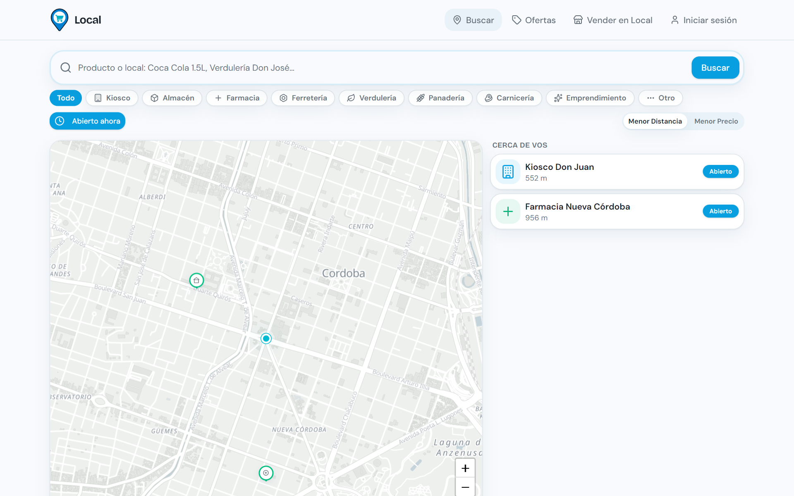
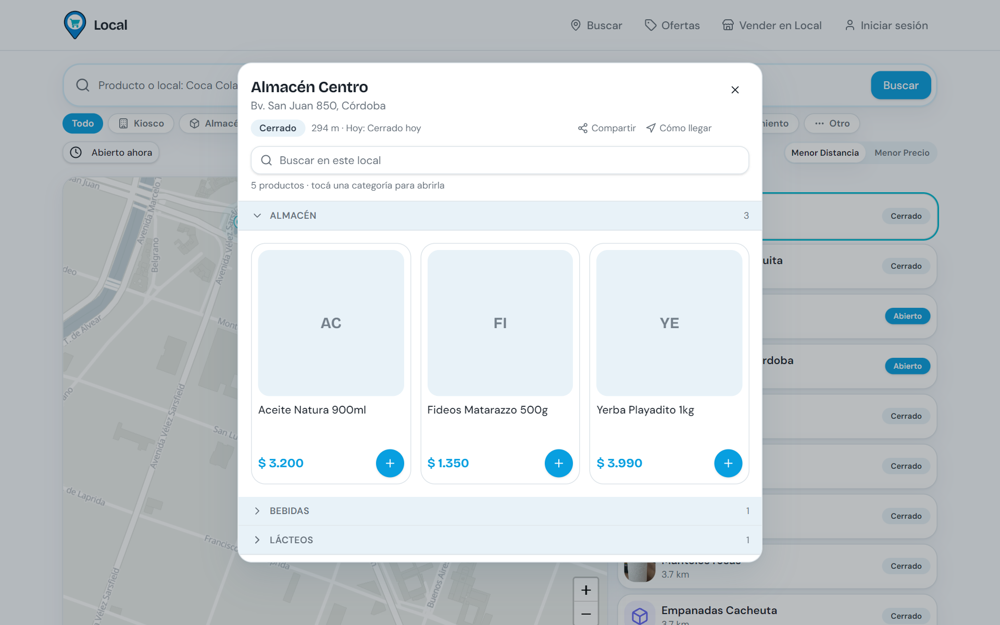
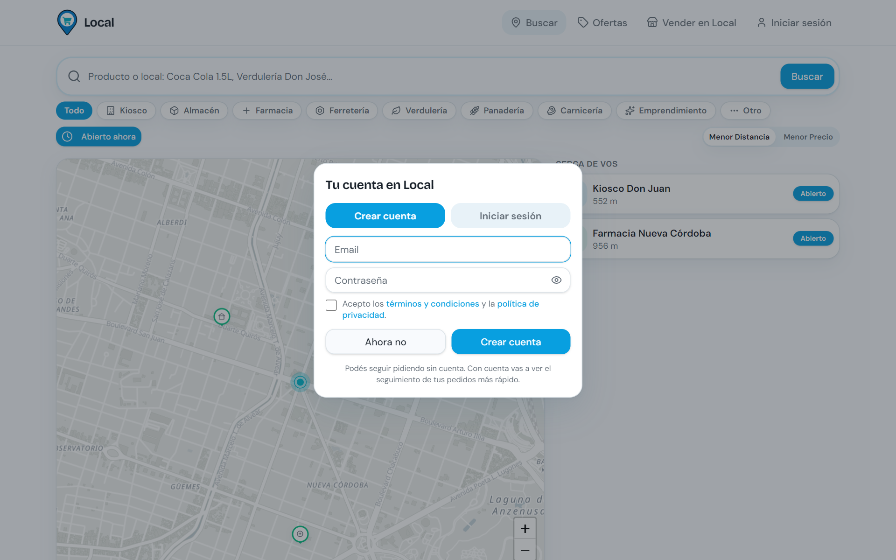
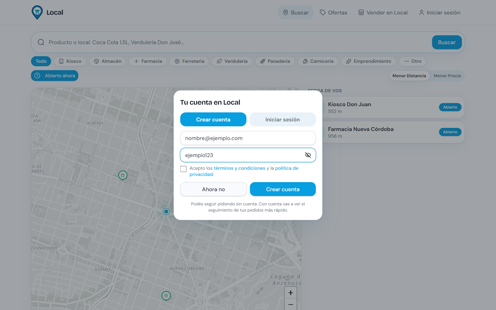
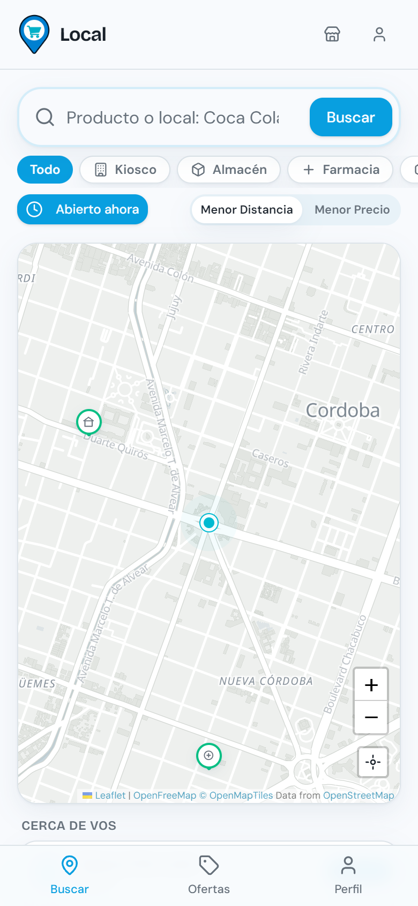
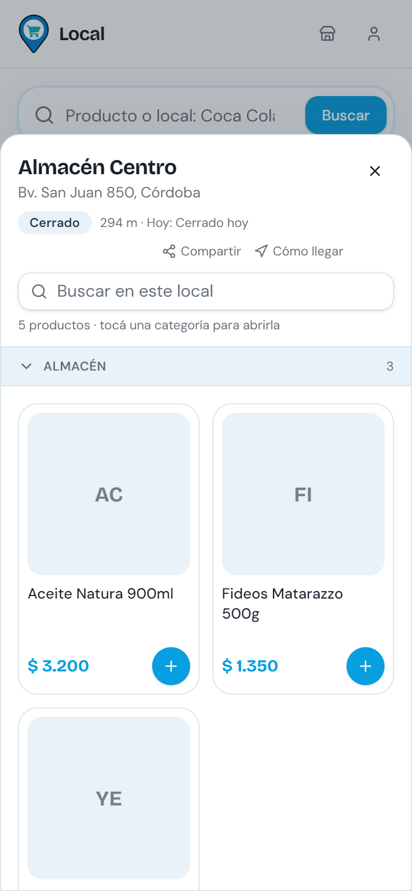
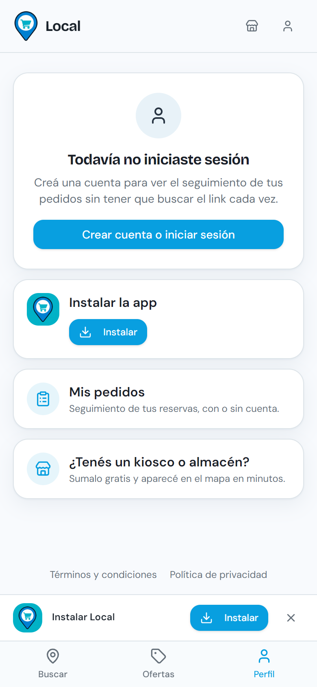
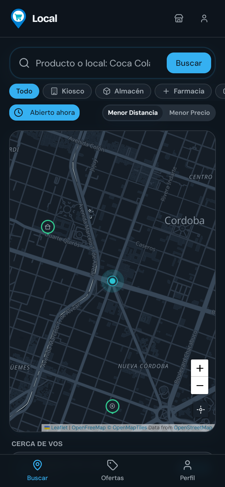

# Local: pruebas (QA), operación y gestión de incidentes

<p align="center"></p>

🇬🇧 **English version:** [README.md](README.md)

Caso de estudio de cómo probé, operé y documenté **[Local](https://localarg.com)**, una aplicación web en funcionamiento que conecta a la gente de Córdoba, Argentina, con los comercios de su barrio.

Este repositorio **no tiene el código de la aplicación**. Tiene el trabajo que la rodea: plan de pruebas, reportes de fallas con su causa, pruebas automáticas, procedimientos y registro de decisiones.

## Mi rol

Soy el encargado del producto, y además su tester y operador.

- **Encargado del producto:** decido qué se construye, en qué orden y cuándo se publica.
- **QA:** pruebas manuales y exploratorias en computadora y celular, reportes de fallas y verificación de cada arreglo en el sitio real.
- **Operación:** dominio, correo, copias de seguridad, publicaciones, seguridad de las cuentas y un tablero de tareas.
- **Desarrollo:** el código lo escriben asistentes de programación con IA (Claude Code) bajo mi dirección. No lo presento como escrito a mano. Lo que aporto es la dirección del producto, las pruebas, la revisión de cada cambio y la disciplina de operación ([cómo trabajo con IA](docs/es/ai-assisted-workflow.md)).

## El producto

Alguien busca un producto, ve en un mapa qué comercios cercanos lo tienen, a qué precio y si están abiertos, y lo reserva para retirar o con envío. El pedido le llega al comercio por WhatsApp. Para pedir no hace falta cuenta. Los comercios se suman gratis en minutos, tienen su propio link y ven un resumen de sus pedidos. Se instala desde el navegador como una app.

**Tecnologías:** TanStack Start (React), Supabase (Postgres, cuentas, seguridad por filas), Cloudflare Workers, Leaflet con mapas vectoriales MapLibre y Resend para el correo.

## Capturas de pantalla

Sacadas del sitio real con `tools/capture-screenshots.mjs`. Los comercios son datos de ejemplo; la ubicación está simulada en el centro de Córdoba y la barra de instalación se muestra simulando el aviso del navegador.

| | |
|---|---|
| <br>Mapa con comercios cercanos y la ubicación de la persona | <br>Ficha del comercio: abierto o cerrado, distancia, categorías y precios |
| <br>Cartel de inicio de sesión, centrado (BUG-001) | <br>Registro: casilla de términos y botón para ver la contraseña |

| | | |
|---|---|---|
| <br>Celular: mapa | <br>Celular: ficha del comercio | <br>Celular: perfil y barra de instalación |

<p align="center"><br>El tema oscuro sigue la configuración del celular</p>

## Qué hay acá

| Archivo | Qué muestra |
|---|---|
| [docs/es/test-plan.md](docs/es/test-plan.md) | Alcance, dispositivos, riesgos y lista de chequeo de cada publicación |
| [docs/es/bug-reports.md](docs/es/bug-reports.md) | Diez fallas reales: qué pasó, causa, arreglo y cómo lo verifiqué |
| [docs/es/runbooks.md](docs/es/runbooks.md) | Publicación, migraciones, copias de seguridad, dominio, correo y seguridad |
| [docs/es/decisions.md](docs/es/decisions.md) | Por qué se tomó cada decisión y qué se descartó |
| [docs/es/ai-assisted-workflow.md](docs/es/ai-assisted-workflow.md) | Cómo dirijo, reviso y verifico el código escrito por IA |
| [docs/es/skills-map.md](docs/es/skills-map.md) | Lo que hice acá, relacionado con puestos de QA, soporte y operaciones |
| [tests/](tests/) | 13 pruebas con Playwright sobre el sitio real, incluidas pruebas de regresión de fallas pasadas |

Todos los documentos también están en inglés en [docs](docs).

## Lo más destacado

- **Una regresión detectada el mismo día que se publicó.** Una migración de la base de datos revirtió en silencio la regla que permite que un cliente se vuelva comerciante, y el panel de comercio dejó de abrir. La encontré recorriendo a mano el alta de un comercio (BUG-003).
- **Andaba en desarrollo y salía vacío en producción.** Una actualización de la librería del mapa se dibujaba en local, pero en el sitio real el mapa salía vacío (BUG-009).
- **Los rastreadores no ejecutan JavaScript.** Los links de los comercios mostraban una vista previa genérica hasta que los datos se entregaron desde el servidor (BUG-005).
- **Los resultados de una prueba pueden engañar.** Las pestañas en segundo plano pausan el dibujo y daban falsos errores (BUG-010).

## Correr las pruebas

```bash
npm install
npx playwright install chromium
npm test
```

Las pruebas son de solo lectura: abren páginas y revisan respuestas, y nunca crean cuentas ni pedidos. Con `BASE_URL` se puede probar otro entorno.

## Sobre mí

Experiencia en QA y operaciones de IA: pruebas manuales y automatizadas (Cypress, Selenium, Playwright), automatizaciones sin código e integraciones (n8n, Make, GoHighLevel, Zapier), soporte técnico y, antes, mantenimiento de aeronaves. Busco puestos remotos en QA, operaciones de IA o de producto, soporte técnico o implementación.

**[LinkedIn: Misael Alejandro Maidana](https://www.linkedin.com/in/misael-alejandro-maidana/)** · **Proyecto: [localarg.com](https://localarg.com)**
-- misael03maidana@gmail.com      //    +549 3516 188386

<sub>Documentación compartida con fines de portfolio. La marca y la aplicación Local pertenecen a sus autores.</sub>
